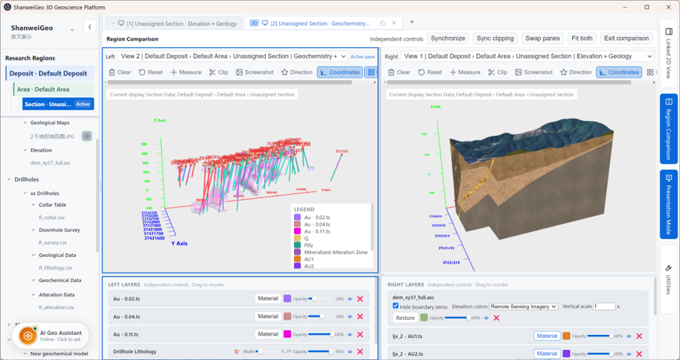

# Screenshots

Reference images of the ShanweiGeo 3D Geoscience Platform in use. Every image
here is a real capture of the application running with the datasets in
`Test data/`, not a mock-up.

The source code for these views lives in this repository:

**<https://github.com/raoyingchun/ShanweiGeo-3D-Geoscience-Platform>**

A browser build of the same application is in
[`Web Version/`](../Web%20Version/) and runs from any modern browser without
Node.js or Electron.

---

## Region comparison

*Linked 2D / 3D comparison. Left: a geological map with drillhole traces
coloured by gold assay. Right: the corresponding 3D block model with a terrain
surface draped over it. The two panes can be viewed independently or
synchronised, and the clipping planes, measurement tools and view reset act on
either side.*

Source: [`ShanweiGeo 3D Geoscience Platform/src/app/region-compare.js`](../ShanweiGeo%203D%20Geoscience%20Platform/src/app/region-compare.js)

### What the screenshot shows

| Area | Content |
|---|---|
| Project tree (left) | Research regions, a deposit and area, geological maps, drillholes with collar and downhole survey tables, and geological and geochemical data |
| Comparison header | Independent controls or synchronised panes, synced clipping, pane swap, fit both, exit comparison |
| Map pane | Drillhole traces on a map, with a legend of gold assay grades |
| 3D pane | The block model with a terrain surface, gold mineralised and alteration zones, and the drillholes in place |
| Layer panels (bottom) | Per-pane layer list with material colour swatches, opacity sliders and visibility toggles |

The map legend lists the gold grade classes `Au- 0.02t`, `Au- 0.04t` and
`Au- 0.11t`, the alteration zones `STZ`, `RTZ` and `Mineralized Alteration
Zone`, and the modelled units `Au1` and `Au2`. The 3D pane layers carry a
`Remote Sensing Imagery` option alongside the elevation surface, so the
terrain can be shown from either the elevation grid or the imagery.

### Reproducing this view

1. Import the drillhole data from `Test data/Drillhole Data` through the
   **Drillholes** category. The collar and downhole survey tables are imported
   first, then the interval table.
2. Import the geological surfaces from `Test data/3D Models/Geological Models`
   through **Geological Data**, and the geochemistry from
   `Test data/Surface`.
3. Open **Region Comparison** from the right-hand function rail. Choose the map
   view for the left pane and the model view for the right pane.
4. Use **Synchronise** to move both cameras together, or **Swap panes** to
   reverse them.

Coordinates, units and grade values are unchanged from the source datasets.
